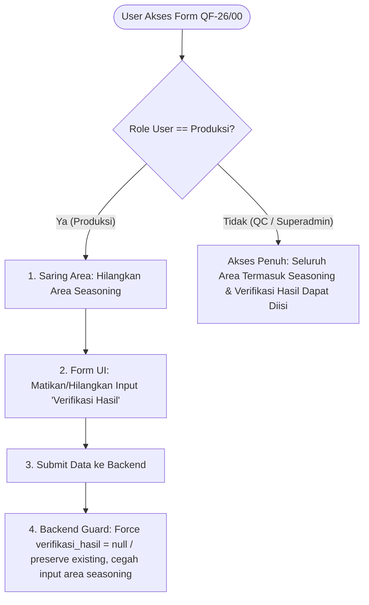

# Rencana Implementasi: Pembatasan Role Produksi pada Form [QF-26/00] Verifikasi Kebersihan Ruangan Mesin & Peralatan

Dokumen ini berisi rencana komprehensif, daftar perubahan kode, dan langkah-langkah implementasi (step-by-step) untuk membatasi hak akses role **Produksi** pada modul form **[QF-26/00] Verifikasi Kebersihan Ruangan Mesin & Peralatan** (`VerifPeralatanController`).

---

## 1. Latar Belakang & Kebutuhan

Pada modul **[QF-26/00] Verifikasi Kebersihan Ruangan Mesin & Peralatan**, role **Produksi** dapat diberikan hak akses CRUD (Create, Read, Update, Delete) melalui manajemen izin (Access Control). Namun, berdasarkan Standard Operating Procedure (SOP) dan batasan kewenangan kerja di lapangan, terdapat 2 (dua) aturan bisnis penting yang harus diterapkan khusus untuk role **Produksi**:

1. **Tidak Boleh Mengisi dan Mengedit "Verifikasi Hasil"**:
   - Kolom **Verifikasi Hasil** (`verifikasi_hasil`) adalah wewenang dari pihak **QC (Quality Control)** untuk memvalidasi apakah kondisi kebersihan mesin/bagian setelah pembersihan atau tindakan koreksi sudah benar-benar memenuhi standar (OK / Tidak OK).
   - Role **Produksi** hanya bertugas memeriksa dan melaporkan kondisi fisik mesin/peralatan (Bersih/Kotor, Keterangan, Tindakan Koreksi).
   - Pada saat **Create (Tambah Data)**: Role Produksi tidak dapat mengisi kolom Verifikasi Hasil (otomatis bernilai `null` atau strip `-`).
   - Pada saat **Edit (Ubah Data)**: Role Produksi tidak dapat mengubah nilai Verifikasi Hasil yang sudah ada (status ditampilkan hanya sebagai label/badge *readonly*).
2. **Menghilangkan Pemilihan Area "Seasoning"**:
   - Pada pemilihan area dinamis di form Create dan Edit, opsi area **Seasoning** harus dihilangkan/disembunyikan khusus untuk role **Produksi**.
   - Mesin dan peralatan yang termasuk ke dalam area Seasoning tidak akan dimuat pada form yang diakses oleh role Produksi.
   - Pihak selain Produksi (seperti Superadmin, Admin, QC Inspector, SPV QC) tetap dapat memilih dan mengisi area Seasoning secara penuh.

---

## 2. Rencana Arsitektur & Logika Perubahan

Perubahan akan dilakukan secara bertingkat pada sisi **Backend (Model & Controller)** untuk integritas data dan keamanan, serta sisi **Frontend (Blade Views & JavaScript)** untuk kenyamanan antarmuka pengguna (UI/UX).



---

## 3. Rincian Perubahan Kode Per Berkas

### A. Berkas `app/Models/User.php`
- **Tujuan**: Menambahkan fungsi pembantu (*helper method*) standar untuk memeriksa apakah user yang sedang aktif memiliki role `produksi`.
- **Perubahan**:
  ```php
  /**
   * LOGIKA: Cek apakah user memiliki role Produksi
   */
  public function isProduksi(): bool
  {
      if ($this->roleModel) {
          return strtolower($this->roleModel->role) === 'produksi';
      }
      return strtolower($this->attributes['role'] ?? '') === 'produksi';
  }
  ```
- **Manfaat**: Konsisten dengan metode `isManager()` yang sudah ada, serta memudahkan pemanggilan di Controller maupun Blade (`auth()->user()->isProduksi()`).

---

### B. Berkas `app/Http/Controllers/VerifPeralatanController.php`

#### 1. Method `create(Request $request)`
- **Logika**:
  - Jika `$user->isProduksi()`, lakukan filter query pada `InputArea` untuk mengecualikan nama area yang mengandung kata `seasoning` (case-insensitive):
    ```php
    $areasQuery = InputArea::with(['subarea'])
        ->where('id_plan', $selectedPlanId);

    if ($user->isProduksi()) {
        $areasQuery->whereRaw('LOWER(area) NOT LIKE ?', ['%seasoning%']);
    }

    $areas = $areasQuery->orderBy('area')->get();
    ```
  - Lakukan hal serupa pada daftar `$mesins` agar mesin yang berada di area seasoning tidak ikut ter-render pada komponen kartu area yang tersembunyi di DOM:
    ```php
    $mesinsQuery = InputMesinPeralatan::with(['area', 'bagian'])
        ->where('id_plan', $selectedPlanId);

    if ($user->isProduksi()) {
        $mesinsQuery->whereHas('area', function ($q) {
            $q->whereRaw('LOWER(area) NOT LIKE ?', ['%seasoning%']);
        });
    }

    $mesins = $mesinsQuery->orderBy('nama_mesin')->get();
    ```

#### 2. Method `edit($uuid)`
- **Logika**:
  - Lakukan penyaringan yang sama untuk `$areas` dan `$mesins` jika `$user->isProduksi()`, sehingga dropdown penambahan area dan section mesin tidak memuat area Seasoning.

#### 3. Method `store(Request $request)`
- **Logika**:
  - Pada saat memproses detail mesin dan bagian:
    - Jika `$user->isProduksi()`:
      - Validasi backend: Lewati (*skip*) atau abaikan jika ada `mesin` dari area Seasoning yang dikirimkan.
      - Tetapkan `$verifHasil = null;` pada detail mesin dan `$bagianHasil = null;` pada detail bagian (bukan default `true`).
    - Jika `$user` bukan produksi (QC, SPV, Superadmin):
      - Proses penyimpanan normal tetap berjalan seperti semula.

#### 4. Method `update(Request $request, $uuid)`
- **Logika**:
  - Pada controller saat ini, proses update menggunakan pola *delete-and-reinsert* (`VerifPeralatanDetail::where('verif_peralatan_id', $item->id)->delete()`).
  - **Proteksi Khusus Produksi**:
    - Sebelum menghapus data lama, simpan mapping nilai existing:
      `$existingDetails = $item->details->keyBy('id_mesin');`
    - Jika `$user->isProduksi()`:
      - Nilai `verifikasi_hasil` tidak diambil dari request `$detail['verifikasi_hasil']`, melainkan **mempertahankan nilai lama** dari data yang sudah ada sebelumnya (`$existingDetails->get($mesinId)?->verifikasi_hasil ?? null`).
      - Hal yang sama berlaku untuk bagian mesin (`$existingBagianDetails->get($bagianId)?->verifikasi_hasil ?? null`).
      - Jika dokumen tersebut sebelumnya sudah memiliki data pada area Seasoning (yang pernah diinput QC), pertahankan baris detail Seasoning tersebut agar tidak terhapus saat user produksi meng-update area lainnya.

---

### C. Berkas `resources/views/qc-sistem/verif_peralatan/create.blade.php`

1. **Pemilihan Area**:
   - Karena `$areas` dari Controller sudah difilter untuk role Produksi, variabel JavaScript `areasList` otomatis tidak akan mengandung opsi Seasoning.
   - Opsi Seasoning tidak akan muncul pada dropdown dinamis `Pilih Area`.
2. **Kolom "Verifikasi Hasil"**:
   - Pada baris mesin (tanpa sub-bagian):
     - Jika `@if(auth()->user()->isProduksi())`: render `<span class="text-muted font-italic">-</span>`.
     - Jika non-produksi: render elemen `<select name="details[{{ $mesin->id }}][verifikasi_hasil]">` seperti biasa.
   - Pada baris sub-bagian mesin:
     - Jika `@if(auth()->user()->isProduksi())`: render `<span class="text-muted font-italic">-</span>`.
     - Jika non-produksi: render elemen `<select name="details[{{ $mesin->id }}][bagian][{{ $bagian->id }}][verifikasi_hasil]">` seperti biasa.
   - **Keuntungan**: JavaScript yang menjalankan loop `inputs.forEach(input => input.removeAttribute('disabled'))` saat area diaktifkan tidak akan menemukan input form untuk `verifikasi_hasil` pada role Produksi, sehingga tidak ada field `verifikasi_hasil` yang dikirim dari browser.

---

### D. Berkas `resources/views/qc-sistem/verif_peralatan/edit.blade.php`

1. **Pemilihan Area**:
   - Area Seasoning tidak muncul pada dropdown penambahan area baru untuk role Produksi.
2. **Kolom "Verifikasi Hasil" (Readonly Badge)**:
   - Pada baris mesin dan bagian:
     - Jika `auth()->user()->isProduksi()`:
       - Tampilkan status Verifikasi Hasil dalam bentuk badge/label non-aktif:
         - Nilai `1`: `<span class="badge badge-success">OK</span>`
         - Nilai `0`: `<span class="badge badge-danger">Tidak OK</span>`
         - Nilai `null`: `<span class="text-muted">-</span>`
       - **Tidak ada input select** yang dirender untuk Produksi, sehingga tidak dapat dimanipulasi atau diubah di layar edit.
     - Jika non-produksi:
       - Tetap menampilkan `<select>` interaktif agar QC/Admin dapat mengubah hasil verifikasi.

---

## 4. Langkah-Langkah Pengerjaan (Step-by-Step Execution Plan)

Berikut urutan tahapan yang akan dieksekusi:

| Tahap | Tindakan | Target Berkas | Output yang Diharapkan |
| :--- | :--- | :--- | :--- |
| **Langkah 1** | Menambahkan helper method `isProduksi()` pada Model User | [User.php](file:///c:/xampp/htdocs/magang/paperless_futher-main/app/Models/User.php) | Helper siap digunakan di Controller dan Blade. |
| **Langkah 2** | Menyesuaikan query `$areas` dan `$mesins` pada method `create()` dan `edit()` di Controller | [VerifPeralatanController.php](file:///c:/xampp/htdocs/magang/paperless_futher-main/app/Http/Controllers/VerifPeralatanController.php) | Area Seasoning dan mesin-mesinnya tidak dikirim ke view jika user adalah Produksi. |
| **Langkah 3** | Menyesuaikan logika `store()` di Controller | [VerifPeralatanController.php](file:///c:/xampp/htdocs/magang/paperless_futher-main/app/Http/Controllers/VerifPeralatanController.php) | User Produksi otomatis menghasilkan `verifikasi_hasil = null` dan memblokir input area Seasoning. |
| **Langkah 4** | Menyesuaikan logika `update()` di Controller | [VerifPeralatanController.php](file:///c:/xampp/htdocs/magang/paperless_futher-main/app/Http/Controllers/VerifPeralatanController.php) | User Produksi mempertahankan nilai `verifikasi_hasil` lama dan tidak menghapus data area Seasoning existing. |
| **Langkah 5** | Memperbarui antarmuka Blade Create | [create.blade.php](file:///c:/xampp/htdocs/magang/paperless_futher-main/resources/views/qc-sistem/verif_peralatan/create.blade.php) | Kolom Verifikasi Hasil menampilkan strip `-` tanpa elemen select untuk Produksi. |
| **Langkah 6** | Memperbarui antarmuka Blade Edit | [edit.blade.php](file:///c:/xampp/htdocs/magang/paperless_futher-main/resources/views/qc-sistem/verif_peralatan/edit.blade.php) | Kolom Verifikasi Hasil menampilkan badge status *readonly* tanpa elemen select untuk Produksi. |
| **Langkah 7** | Verifikasi Sintaks & Logika Kode | Terminal / PHP Lint | Memastikan tidak ada syntax error (`php -l`) pada berkas yang diubah. |

---

## 5. Rencana Pengujian (Testing & Verification Plan)

Setelah implementasi diterapkan, pengujian akan dilakukan berdasarkan skenario berikut:

1. **Skenario 1 - Login sebagai User Produksi (Create Form)**:
   - Buka halaman `verif-peralatan/create`.
   - Buka dropdown **Pilih Area**: Pastikan opsi **Seasoning** tidak ada di dalam daftar pilihan.
   - Pilih salah satu area (misal: Ruang Proses / Battering).
   - Periksa tabel: Kolom **Verifikasi Hasil** hanya menampilkan tanda strip `-` dan tidak dapat diklik/diubah.
   - Simpan data: Pastikan data tersimpan dengan sukses dan di database kolom `verifikasi_hasil` bernilai `null`.
2. **Skenario 2 - Login sebagai User Produksi (Edit Form)**:
   - Buka data yang sudah memiliki nilai Verifikasi Hasil (OK / Tidak OK) dari QC.
   - Akses halaman `verif-peralatan/{uuid}/edit`.
   - Pastikan kolom **Verifikasi Hasil** menampilkan badge status (*Readonly*) dan tidak ada dropdown untuk mengubahnya.
   - Pastikan opsi penambahan area tidak memunculkan area Seasoning.
   - Simpan data edit: Pastikan nilai `verifikasi_hasil` sebelumnya tetap utuh dan tidak berubah menjadi default `true` atau terhapus.
3. **Skenario 3 - Login sebagai QC Inspector / Superadmin**:
   - Buka form Create dan Edit.
   - Pastikan area **Seasoning** tetap tersedia dan dapat dipilih secara normal.
   - Pastikan kolom **Verifikasi Hasil** tetap berupa dropdown interaktif (`OK` / `Tidak OK`) dan dapat disimpan secara normal.


---

## 6. Aturan Khusus Role QC Inspector pada Form Edit

### A. Kebutuhan
Role **QC Inspector** pada halaman Edit (`verif-peralatan/{uuid}/edit`) hanya memiliki kewenangan untuk mengisi dan memperbarui kolom **Verifikasi Hasil** (`verifikasi_hasil`). Seluruh data lainnya bersifat *read-only* untuk menjaga orisinalitas data yang diinput oleh pelapor/pembuat awal.

### B. Perubahan yang Diterapkan
1. **Helper Method**: Menambahkan `isQcInspector(): bool` pada [User.php](file:///c:/xampp/htdocs/magang/paperless_futher-main/app/Models/User.php).
2. **Form Edit ([edit.blade.php](file:///c:/xampp/htdocs/magang/paperless_futher-main/resources/views/qc-sistem/verif_peralatan/edit.blade.php))**:
   - Menampilkan alert info: *Mode QC Inspector*.
   - `Shift`: Ditampilkan sebagai teks *read-only* (dengan input hidden `id_shift`).
   - `Tanggal`: Input tanggal diatur menjadi `readonly`.
   - Tombol **Tambah Area** & **Check All Bersih** & tombol hapus area disembunyikan.
   - Kolom **Kondisi**: Ditampilkan dalam bentuk badge (*Bersih* / *Kotor* / *-*), bukan `<select>`.
   - Kolom **Keterangan**: Ditampilkan dalam bentuk teks biasa, bukan `<select>`.
   - Kolom **Tindakan Koreksi**: Ditampilkan dalam bentuk teks biasa, bukan `<textarea>`.
   - Kolom **Verifikasi Hasil**: Menjadi **satu-satunya field interaktif** (`<select>`) dengan pilihan `-`, `OK`, dan `Tidak OK`.
3. **Controller ([VerifPeralatanController.php](file:///c:/xampp/htdocs/magang/paperless_futher-main/app/Http/Controllers/VerifPeralatanController.php))**:
   - Pada method `update()`, jika user adalah `QC Inspector`, sistem **hanya memperbarui nilai `verifikasi_hasil`** pada baris detail mesin dan sub-bagian mesin yang ada di database.
   - Nilai header (`id_shift`, `tanggal`, `jam`) serta data detail (`verifikasi`, `keterangan`, `tindakan_koreksi`) tetap aman dipertahankan tanpa ditimpa atau dihapus.
